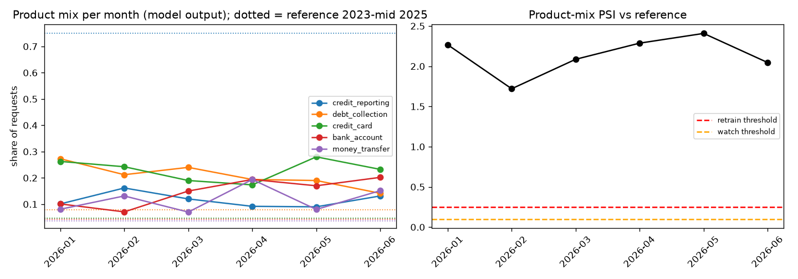

# Complaint extraction with a small fine-tuned LLM

Reads a US consumer financial complaint written in free text and returns its key facts as JSON:

```json
{"product_group": "credit_card", "issue": "fees_interest", "company": "Citi",
 "amount_in_dispute": 35.0, "contacted_company_first": true, "requested_resolution": "refund"}
```

The question behind the project: can a small model, trained on labels from a large one, get
close enough at a fraction of the cost, run on an ordinary laptop, and be monitored once the
complaints it sees start to look different?

**Status:** the full pipeline runs end to end, from raw data to a served model with drift
monitoring. The model results below are a **CPU pilot** (135M-parameter student, 1,600 training
examples) because the full-scale steps need a GPU; the code and the Kaggle notebook for the
full run are in place. See [Results](#results) and [Limits](#limits).

## Data

[CFPB Consumer Complaint Database](https://www.consumerfinance.gov/data-research/consumer-complaints/)
(Hugging Face mirror): 16.6M complaints, 3.8M with a written narrative, 2015 to June 2026.
Personal details are redacted by the CFPB (`XXXX`; from 2024 even years: `XX/XX/year>`).

After cleaning and de-duplication (exact + MinHash near-duplicates, earliest copy kept), the data
is split **by date**, so evaluation looks like deployment:

| Split | Period | Rows | Sampling |
|---|---|---|---|
| train | 2015 to Jun 2025 | 20,000 | 2,000 per product group |
| val | Jul to Dec 2025 | 5,000 | 500 per product group |
| replay | Jan to Jun 2026 | 10,000 | natural mix (stands in for live traffic) |

## Pipeline

| Phase | What | Code |
|---|---|---|
| 1 | Download narratives, data-quality gate | `data/check_data.py` |
| 2 | Clean, dedupe, date split, sample | `data/prep.py` |
| 3 | Label schema; teacher labels (Qwen2.5-14B on a free Kaggle GPU); 200-row gold set | `label/`, `notebooks/label_kaggle.ipynb` |
| 4 | Evaluation harness; baselines (rules, prompted small models, teacher) | `eval/` |
| 5 | LoRA fine-tuning of the student | `train/train_lora.py` |
| 6 | Error analysis | `eval/errors.py` |
| 7 | Merge + int8 quantisation, latency and cost | `train/package.py` |
| 8 | HTTP service with request log | `serve/app.py` |
| 9 | Replay 2026 traffic through the service, drift report | `monitor/` |

Design notes, every decision and its reason, and an interview question per phase are in
[NOTES.md](NOTES.md).

### Label schema

| Field | Values |
|---|---|
| `product_group` | 10 groups; the CFPB's own filed product (known for every complaint) |
| `issue` | 13 categories with a precedence order (`label/schema.py`) |
| `company` | name as written, or null if redacted |
| `amount_in_dispute` | number or null (no amount in ~65% of recent complaints) |
| `contacted_company_first` | true / false / null |
| `requested_resolution` | refund, deletion, correction, stop_contact, other, or null (explicit asks only) |

## Results

All numbers on the 200-row gold set (val, Jul-Dec 2025; product scored against the CFPB's own
product). Full tables, decisions and caveats: [NOTES.md](NOTES.md), [MODEL_CARD.md](MODEL_CARD.md).

| Model | Valid JSON | Product | Issue | Company | Amount has / none | Contacted | Resolution |
|---|---|---|---|---|---|---|---|
| keyword rules | 100% | 52.0% | 34.0% | 53.0% | 77.6% / 88.7% | 58.0% | **61.5%** |
| Qwen2.5-0.5B, prompted, no tuning | 100% | 19.4%* | 23.0% | 71.5% | 72.4% / 42.3% | 64.0% | 12.5% |
| Qwen2.5-1.5B, prompted, no tuning | 83.5% | 40.7% | 26.9% | 79.0% | 77.6% / 86.4% | 73.7% | 38.9% |
| **student: SmolLM2-135M + LoRA (CPU pilot)** | **99.0%** | 51.5% | 27.3% | 79.3% | 81.0% / 90.7% | 75.3% | 26.3% |
| teacher: Qwen2.5-14B-AWQ | 100% | **60.0%** | **50.5%** | **88.5%** | **84.5% / 94.4%** | **86.5%** | 46.5% |

\* on all 5,000 val rows.

**What the pilot shows**
- Fine-tuning a 135M model on 1,600 teacher labels (160 min on a laptop CPU) gives valid JSON 99%
  of the time and gets close to the 14B teacher on the fields copied from the text (company,
  amount, contacted). Prompting larger untuned models (0.5B, 1.5B) does worse.
- On the category fields (issue, resolution) it is weak. Error analysis traces most of the
  resolution gap to the labels, not the model: it agrees 57% with its teacher but 26% with the gold
  set, because the teacher labels used the first (v1) definitions. Prompt v2 fixes the definitions;
  relabelling needs the GPU run.
- The gold set itself shows the teacher's ceiling on these fields is set by definition clarity:
  52% on issue and resolution under the first definitions.

**Serving and cost** (2-core 2017 laptop CPU, batch size 1): 513 MB fp32 model, ~6 s per
complaint, 1.8 CPU-hours per 1,000 complaints, no GPU. PyTorch int8 quantisation broke the model
(0/30 valid), so it serves fp32.

**Drift** (600 complaints from Jan-Jun 2026 replayed through the service): the monitor raises a
retrain alert every month. Credit reporting falls from 75% of complaints to 0-2% (product-mix PSI
3.7-7.9 on the true product, 1.7-2.4 on the model's answers, threshold 0.25) and the median
complaint grows from 108 to 164-223 words. Valid output stays at 98-100%.
See [reports/drift.md](reports/drift.md).



## How to run

Needs Python 3.11 and [uv](https://docs.astral.sh/uv/). On Windows set `PYTHONUTF8=1`.

```bash
uv sync                                   # core: data, labels, evaluation
uv sync --group ml                        # + training, serving, monitoring (PyTorch CPU)
uv run pytest                             # all tests, no download needed

uv run python data/check_data.py          # phase 1: ~1 GB download, once
uv run python data/prep.py                # phase 2: ~3 min
# phase 3: run notebooks/label_kaggle.ipynb on Kaggle (GPU T4 x2), copy labels to data/labels/
uv run python eval/rules.py --split val   # phase 4
uv run python eval/evaluate.py data/labels/val.jsonl

# phase 5-7 (CPU pilot; on a GPU use a larger --model and the full train labels)
uv run --group ml python train/train_lora.py --model HuggingFaceTB/SmolLM2-135M-Instruct \
    --labels data/labels/val_v1.jsonl --n-train 1600 --lr 3e-4 --max-len 768 --out models/pilot
uv run --group ml python train/predict.py --adapter models/pilot/adapter --gold-only
uv run python label/gold.py score data/predictions/student_pilot_val_gold.jsonl
uv run --group ml python train/package.py --adapter models/pilot/adapter

# phase 8-9
MODEL_DIR=models/pilot/merged uv run --group ml uvicorn serve.app:app --port 8000
MODEL_DIR=models/pilot/merged uv run --group ml python monitor/replay.py --per-month 100
uv run --group ml python monitor/drift.py --ref-accuracy 0.515
```

## Limits

- **Pilot scale.** No GPU was available, so the student is 135M parameters trained on 1,600
  val rows with teacher labels. The planned run (teacher labels for the 20k train rows with prompt
  v2, a 0.5-1.5B student) is ready in `notebooks/label_kaggle.ipynb` and `train/train_lora.py`.
- **Same-period evaluation.** The pilot trains and tests on Jul-Dec 2025 complaints (different
  complaints, de-duplicated), so gold scores lack the time gap the design calls for; the 2026
  replay covers it.
- **Gold set by a model.** 199 of 200 gold rows were labelled blind by Claude from the text, using
  the written definitions; it is a second-model reference, not human ground truth.
- **Label definitions.** The teacher labels for val use prompt v1; the gold set uses v2.
- **Redacted data.** Names, dates and, since 2024, years are removed by the CFPB, which caps what
  any model can extract.
- **Sampling.** The replay uses 100 complaints per month (600 of 10,000) to fit CPU time.
