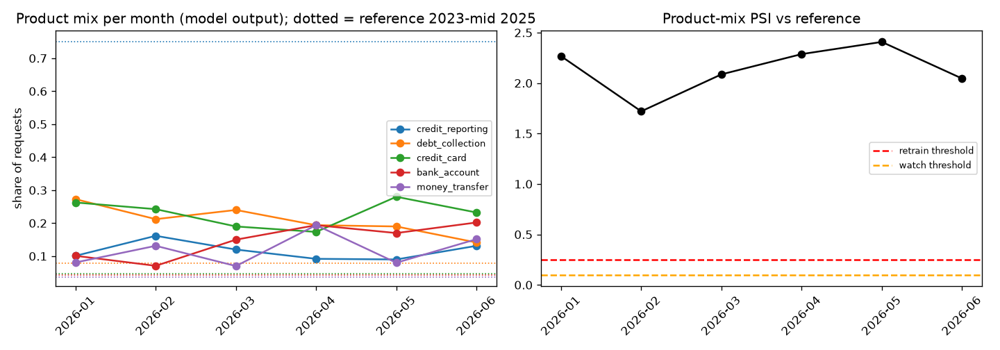

# Replay drift report

Reference: natural traffic 2023-01-01 to 2025-07-01 (1,951,949 complaints), median 108 words, credit_reporting 75% of complaints. Product accuracy on val: 51.5%.

| Month | Rows | Valid | PSI product (model) | PSI product (CFPB truth) | credit_reporting share (truth) | Product acc. | Median words | Latency p50 (ms) | Null: company / amount / contacted / resolution |
|---|---|---|---|---|---|---|---|---|---|
| 2026-01 | 100 | 99.0% | 2.27 | 3.74 | 2% | 67.7% | 164 | 5434 | 34% / 68% / 20% / 0% |
| 2026-02 | 100 | 99.0% | 1.72 | 3.71 | 2% | 58.6% | 183 | 5338 | 25% / 51% / 13% / 0% |
| 2026-03 | 100 | 100.0% | 2.09 | 4.30 | 1% | 67.0% | 176 | 5387 | 31% / 58% / 17% / 0% |
| 2026-04 | 100 | 98.0% | 2.29 | 4.31 | 1% | 57.1% | 179 | 5325 | 38% / 56% / 18% / 0% |
| 2026-05 | 100 | 100.0% | 2.41 | 7.81 | 0% | 62.0% | 223 | 6026 | 27% / 55% / 14% / 0% |
| 2026-06 | 100 | 99.0% | 2.05 | 7.93 | 0% | 64.6% | 202 | 5826 | 20% / 54% / 16% / 0% |

## Alerts

- **RETRAIN** 2026-01: product mix PSI 2.27 > 0.25
- **watch** 2026-01: median length 164 words (+52% vs reference)
- **RETRAIN** 2026-02: product mix PSI 1.72 > 0.25
- **watch** 2026-02: median length 183 words (+69% vs reference)
- **RETRAIN** 2026-03: product mix PSI 2.09 > 0.25
- **watch** 2026-03: median length 176 words (+63% vs reference)
- **RETRAIN** 2026-04: product mix PSI 2.29 > 0.25
- **watch** 2026-04: median length 179 words (+66% vs reference)
- **RETRAIN** 2026-05: product mix PSI 2.41 > 0.25
- **watch** 2026-05: median length 223 words (+106% vs reference)
- **RETRAIN** 2026-06: product mix PSI 2.05 > 0.25
- **watch** 2026-06: median length 202 words (+87% vs reference)

## Rules

- `psi_product_major` = 0.25
- `psi_product_moderate` = 0.1
- `valid_rate_min` = 0.95
- `length_median_change` = 0.25
- `accuracy_drop` = 0.1
- `min_rows` = 30
